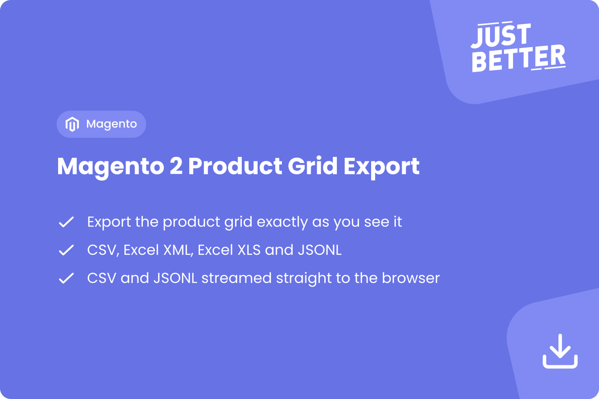
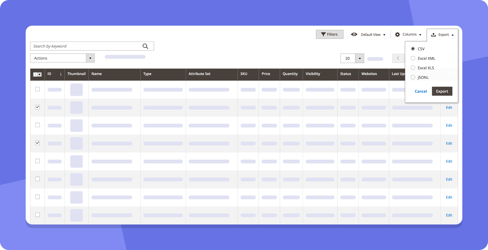

<a href="https://github.com/justbetter/magento2-product-grid-export" title="JustBetter">
    
</a>
<h1>JustBetter - Magento 2 Product Grid Export</h1>

[![Latest Version on Packagist][packagist-version-shield]][packagist-version-url]
[![MIT License][license-shield]][license-url]
[![Total Downloads][packagist-downloads-shield]][packagist-downloads-url]
[![Stargazers][stars-shield]][stars-url]
[![Issues][issues-shield]][issues-url]
[![Contributors][contributors-shield]][contributors-url]
[![Forks][forks-shield]][forks-url]

<br />
<div>
  <p>
    Adds the export button that other admin grids already have to the Magento 2 product grid.
    <br />
    <a href="https://github.com/justbetter/magento2-product-grid-export/issues">Report Bug</a>
    ·
    <a href="https://github.com/justbetter/magento2-product-grid-export/issues">Request Feature</a>
  </p>
</div>

<details>
  <summary>Table of Contents</summary>
  <ol>
    <li>
      <a href="#about-the-package">About The Package</a>
      <ul>
        <li><a href="#built-with">Built With</a></li>
        <li><a href="#contributors">Contributors</a></li>
      </ul>
    </li>
    <li>
      <a href="#getting-started">Getting Started</a>
      <ul>
        <li><a href="#installation">Installation</a></li>
      </ul>
    </li>
    <li>
      <a href="#features">Features</a>
      <ul>
        <li><a href="#export-formats">Export formats</a></li>
      </ul>
    </li>
    <li><a href="#usage">Usage</a></li>
    <li><a href="#contributing">Contributing</a></li>
    <li><a href="#license">License</a></li>
    <li><a href="#contact">Contact</a></li>
  </ol>
</details>

## About The Package

This Magento 2 extension made by [JustBetter](https://justbetter.nl) adds the same export button that other admin grids like the order grid have to the product grid.
The export is an exact replica of the grid you see: the same columns, filters, keyword search and selection.

### Built With

* [![PHP][PHP-badge]][PHP-url]
* [![Magento][Magento-badge]][Magento-url]

### Contributors

Thanks to all the people who have contributed to this project:

<a href="https://github.com/justbetter/magento2-product-grid-export/graphs/contributors">
  
</a>

## Getting Started

### Installation

1. Install via Composer
   ```sh
   composer require justbetter/magento2-product-grid-export
   ```

   Composer also installs the dependencies [justbetter/magento2-core](https://github.com/justbetter/magento2-core) (`JustBetter_Core`) and [indykoning/php-jsonl](https://github.com/indykoning/php-jsonl).

2. Enable the modules
   ```sh
   bin/magento module:enable JustBetter_Core JustBetter_ProductGridExport
   ```

3. Run setup upgrade
   ```sh
   bin/magento setup:upgrade
   ```

4. In production mode, compile the dependency injection configuration
   ```sh
   bin/magento setup:di:compile
   ```

## Features

- Export button on the admin product grid, next to the "Columns" dropdown
- Four export formats: CSV, Excel XML, Excel XLS and JSONL
- Exports exactly what the grid shows
    - Only the visible columns, in the order of your saved grid view
    - Active filters and keyword search
    - The selected products, a single page or all products ("Select All")
- Readable values instead of internal IDs
    - Select and multiselect attributes are exported as their option labels, e.g. `quantity_and_stock_status` as "In Stock" / "Out of Stock"
    - Attribute sets and websites are exported by name
- Suitable for large catalogs: products are loaded in batches of 200, and CSV and JSONL exports are streamed to the browser while they are generated

### Export formats

| Format    | File           | Description |
|-----------|----------------|-------------|
| CSV       | `export.csv`   | A header row with the column labels, followed by one row per product. Streamed to the browser while it is generated. |
| Excel XML | `export.xml`   | Excel 2003 XML spreadsheet (SpreadsheetML). Generated as a file first, then downloaded. |
| Excel XLS | `export.xls`   | The same SpreadsheetML output as Excel XML with an `.xls` extension, not a binary Excel file. Generated as a file first, then downloaded. |
| JSONL     | `export.jsonl` | One JSON object per product per line, keyed by column code. Multi-value columns such as websites stay arrays. Streamed to the browser while it is generated. |

In CSV, Excel XML and Excel XLS, multi-value columns are joined into a single comma-separated value.

Because CSV and JSONL exports are streamed, large catalogs can be exported without running into memory or time limits.

## Usage

After installation the "Export" button is shown next to the "Columns" dropdown on the product grid (`Catalog > Products`).

1. Set up the grid the way you want the export to look: pick the columns, apply filters or search by keyword.
2. Select the products you want to export: a couple of products, a single page or all products with "Select All".
3. Click "Export", choose a format and click "Export" again to download the file.



## Contributing

Please read our [Contributing Guide](.github/CONTRIBUTING.md) for details on the process for submitting pull requests.

**Development:**

```bash
# Install dependencies
composer install

# Run static analysis (PHPStan)
composer analyse

# Fix and check the code style (PHPCS, Magento Coding Standard)
composer codestyle
```

For security vulnerabilities, please see our [Security Policy](.github/SECURITY.md).

## License

Distributed under the MIT License. Please see [License File](LICENSE) for more information.

## Contact

[JustBetter B.V.](https://justbetter.nl/contact)

<a href="https://justbetter.nl" title="JustBetter">
    
</a>

<!-- MARKDOWN LINKS & IMAGES -->
[packagist-version-shield]: https://img.shields.io/packagist/v/justbetter/magento2-product-grid-export.svg?style=for-the-badge
[packagist-version-url]: https://packagist.org/packages/justbetter/magento2-product-grid-export
[packagist-downloads-shield]: https://img.shields.io/packagist/dt/justbetter/magento2-product-grid-export.svg?style=for-the-badge
[packagist-downloads-url]: https://packagist.org/packages/justbetter/magento2-product-grid-export
[contributors-shield]: https://img.shields.io/github/contributors/justbetter/magento2-product-grid-export.svg?style=for-the-badge
[contributors-url]: https://github.com/justbetter/magento2-product-grid-export/graphs/contributors
[forks-shield]: https://img.shields.io/github/forks/justbetter/magento2-product-grid-export.svg?style=for-the-badge
[forks-url]: https://github.com/justbetter/magento2-product-grid-export/network/members
[stars-shield]: https://img.shields.io/github/stars/justbetter/magento2-product-grid-export.svg?style=for-the-badge
[stars-url]: https://github.com/justbetter/magento2-product-grid-export/stargazers
[issues-shield]: https://img.shields.io/github/issues/justbetter/magento2-product-grid-export.svg?style=for-the-badge
[issues-url]: https://github.com/justbetter/magento2-product-grid-export/issues
[license-shield]: https://img.shields.io/github/license/justbetter/magento2-product-grid-export.svg?style=for-the-badge
[license-url]: https://github.com/justbetter/magento2-product-grid-export/blob/master/LICENSE
[phpstan-shield]: https://img.shields.io/github/actions/workflow/status/justbetter/magento2-product-grid-export/analyse.yml?label=PHPStan&style=for-the-badge
[phpstan-url]: https://github.com/justbetter/magento2-product-grid-export/actions/workflows/analyse.yml
[codestyle-shield]: https://img.shields.io/github/actions/workflow/status/justbetter/magento2-product-grid-export/phpcs.yml?label=Code%20Style&style=for-the-badge
[codestyle-url]: https://github.com/justbetter/magento2-product-grid-export/actions/workflows/phpcs.yml

[PHP-badge]: https://img.shields.io/badge/PHP-777BB4?style=for-the-badge&logo=php&logoColor=white
[PHP-url]: https://www.php.net/
[Magento-badge]: https://img.shields.io/badge/Magento-EE672F?style=for-the-badge&logo=magento&logoColor=white
[Magento-url]: https://business.adobe.com/products/magento/magento-commerce.html
